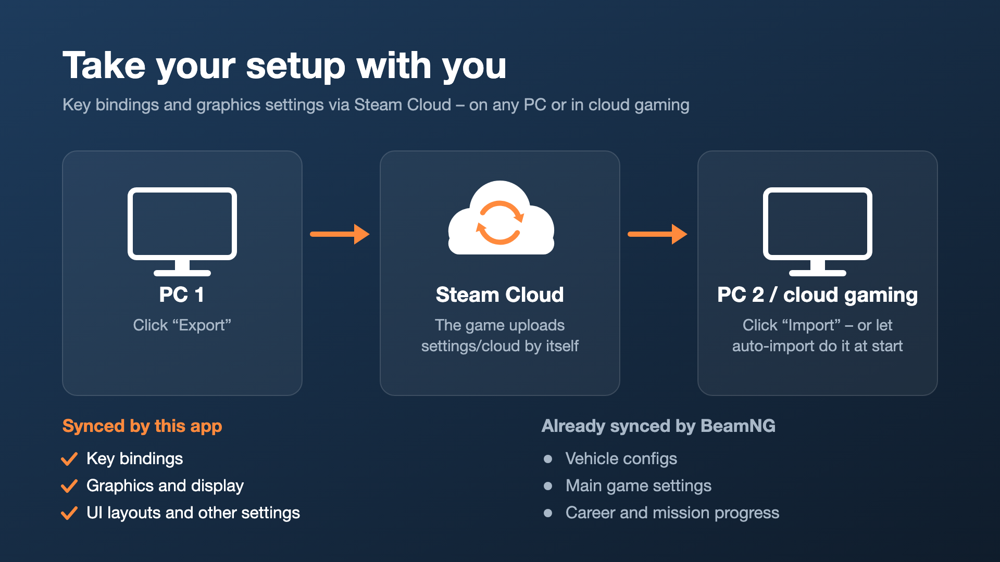
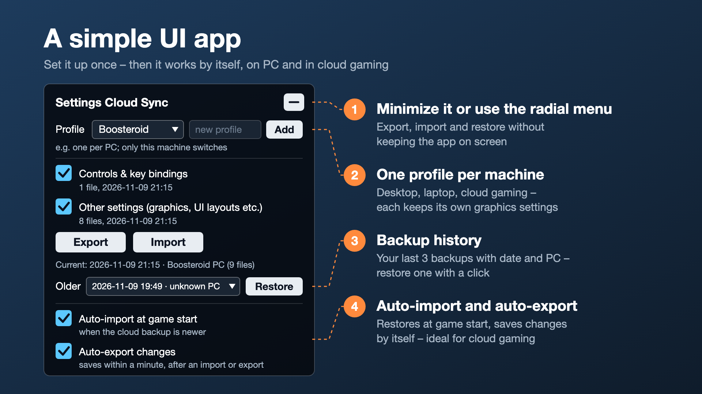

<p align="center"></p>

# Settings Cloud Sync for BeamNG.drive

Take your setup with you. BeamNG.drive already syncs your main game settings and your own vehicle configs via Steam Cloud – but not your **key bindings** or **graphics settings**. This UI app puts them into the game's Steam Cloud folder (`settings/cloud`), so you can restore them on another PC or on a cloud gaming service like Boosteroid.

**Install:** [Settings Cloud Sync in the BeamNG repository](https://www.beamng.com/resources/settings-cloud-sync.40234/)



## Features

- **Export / Import** of key bindings (`settings/inputmaps`) and other settings files from your user folder
- **Auto-import** at game start when the cloud backup is newer than the local settings – ideal for cloud gaming, where every session starts fresh
- **Auto-export** within a minute after a change and when you quit (only after this machine has imported or exported once, so a fresh session never overwrites your backup with defaults)
- **Profiles** per machine (e.g. Desktop, Laptop, Boosteroid), each with its own backup
- **Backup history**: the 3 previous backups per profile, labelled with date and PC name, restorable from the app or the radial menu
- Export, Import and Restore in the **radial menu**; the app can be minimized
- Settings panel in the **pause menu** under “Mods” (v0.6, in development)



## Cloud gaming (Boosteroid etc.)

Every session starts like a fresh install – settings *and* mods are gone, including this one. Set it up once, then each session takes 20 seconds:

1. **Once:** install the mod, add the app, tick “Auto-import at game start” and “Auto-export changes”, click “Export”.
2. **Every new session:** find “Settings Cloud Sync” in the repository and activate it. Your settings are restored automatically, no restart needed.
3. Quit the game via the menu, so Steam can upload your settings.

## Console

```lua
settingsCloudSync.exportAll()
settingsCloudSync.importAll()
settingsCloudSync.setProfile('Laptop')
```

## Repository layout

| Path | Content |
|---|---|
| `mods/SettingsCloudSync/` | Mod source: Lua extension (`lua/ge/extensions/`), UI app (`ui/modules/apps/`), pause menu panel (`ui/ui-vue/mods/`) |
| `mods/CloudSyncTest/` | Diagnostic mod used during development (not published) |
| `build.sh` | Packs the mods as zip files into `dist/` |
| `grafik/` | Icon and repository graphics (SVG + PNG) |
| `docs/` | Development notes, research and test plans |

## Build

```sh
./build.sh
```

Creates `dist/settings_cloud_sync_martindoersch.zip`. Drop it into your BeamNG `mods` folder to test.

## Privacy

Only text files from your own BeamNG user folder are copied into the game's own Steam Cloud folder. Nothing leaves your Steam account.

## License

[MIT](LICENSE) © Martin Dörsch
